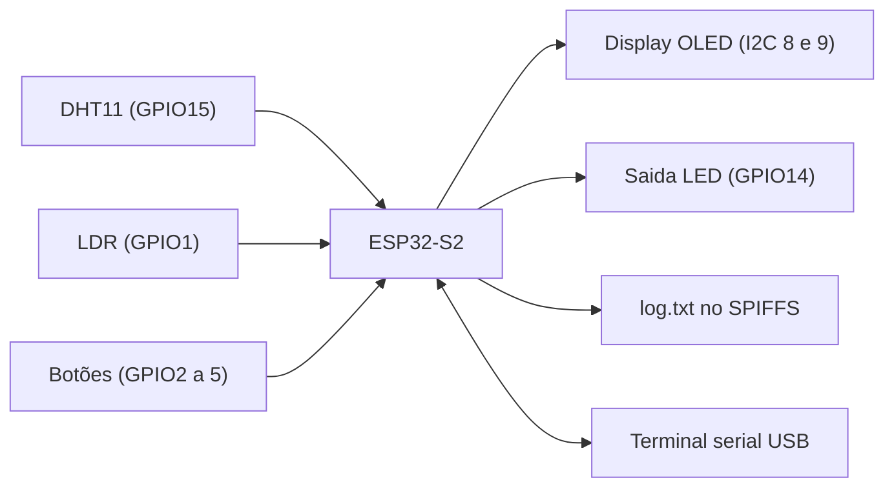
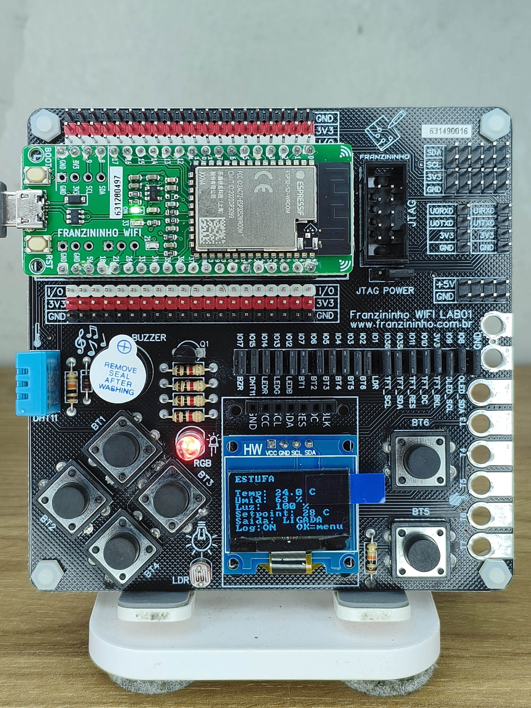
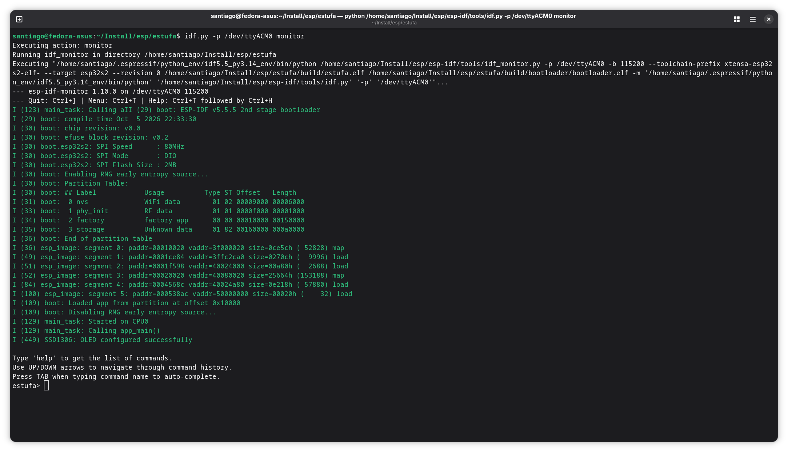

# Estufa - Projeto Final Modulo II

Um sistema de monitoramento e controle de uma estufa feito na Franzininho WiFi LAB01 (ESP32-S2) com ESP-IDF.

Lê a temperatura e a umidade (DHT11) e a luminosidade (LDR), mostra os valores no display OLED e liga uma saida (LED vermelho, fazendo o papel do aquecedor) quando a temperatura fica abaixo do limite. Os dados sao salvos no arquivo log.txt (SPIFFS) e podem ser lidos pelo terminal serial.

## Diagrama de blocos



## Como compilar e gravar

```
idf.py set-target esp32s2
idf.py menuconfig
idf.py build
idf.py -p /dev/ttyACM0 flash
idf.py -p /dev/ttyACM1 monitor
```

Para gravar: segurar BOOT, apertar RESET, soltar BOOT. Depois de gravar, apertar RESET.

No menuconfig, em "Configuracao da Estufa", da para mudar os pinos, o setpoint inicial e o intervalo do log.

## Como usar

- Tela principal: temperatura, umidade, luz, setpoint, saida e log.
- OK abre o menu.
- No menu: CIMA e BAIXO escolhem o item, OK altera.
  - Setpoint: CIMA e BAIXO mudam o valor, OK confirma.
  - Controle: liga ou desliga o controle.
  - Registro: liga ou desliga a gravacao do log.
- VOLTAR sai do menu.

No terminal, o comando `log` mostra o conteudo do log.txt.

## Exemplos de funcionamento





## Arquivos

- `main/main.c`: programa principal (menu, tela e controle)
- `components/sensores`: leitura do DHT11 e do LDR
- `components/arquivo_log`: gravacao e leitura do log.txt
- `components/dht` e `components/ssd1306`: drivers usados no curso
